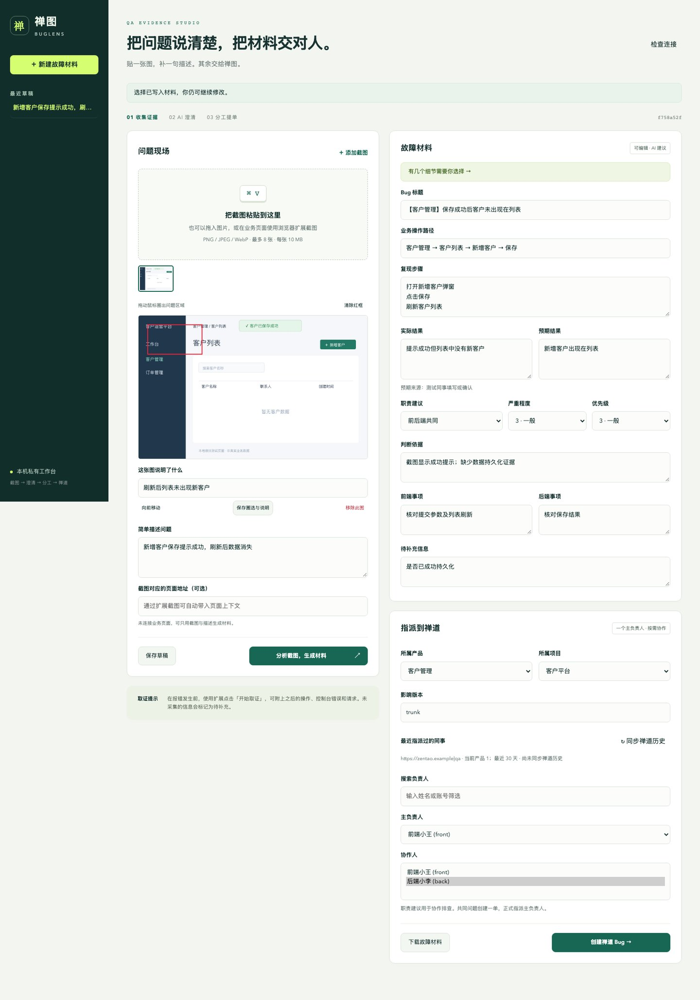

# 禅图 BugLens · Screenshot-to-ZenTao

**Paste a screenshot, explain the symptom, choose the suggested details, and send a well-formed bug to the right developer.** Built for QA colleagues, with a Chinese-first workbench.

[中文完整说明](./README.zh-CN.md) · [Configuration and deployment](./docs/CONFIGURATION.md) · [Development and release](./docs/DEVELOP-PUBLISH.md)



## Two independent entry points

| Deliverable | Installation | What it does |
| --- | --- | --- |
| **DSH plugin** | `dsh plugin --profile web add dsh-zentao-buglens@0.1.0` | Registers 10 `buglens_*` tools with DSH. |
| **Agent Skill** | `npx --yes dsh-zentao-buglens@0.1.0 install-skill` | Installs `zentao-buglens` into `~/.agents/skills`; no DSH required. |

The browser extension and local core service support both entry points. The Skill is also provided as a separate ZIP in GitHub Releases. Node.js 22.15+ is required for the standalone service; the tested DSH release requires Node.js 24.9+ and pnpm 10+.

The standard Skills CLI can also install the independent skill: `npx skills add zhan1024/dsh-zentao-buglens --skill zentao-buglens -a codex -g`. Installation is separate from third-party directory indexing.

## Start using it

```sh
# Standalone workbench, also used by the Skill
npx --yes dsh-zentao-buglens@0.1.0 open

# DSH entry point
dsh plugin --profile web add dsh-zentao-buglens@0.1.0
dsh web
```

In DSH ask: “打开禅图 BugLens，我要根据截图创建禅道 Bug。” The agent calls `buglens_open`.

Before AI analysis or submission, an administrator configures a vision-capable Chat Completions gateway and each tester's ZenTao identity. See [the configuration guide](./docs/CONFIGURATION.md). Reports can be edited/exported independently; unconfigured integrations never simulate successful submission.

For an existing business-browser session, download and extract the browser extension ZIP from Releases, or install the CLI and run `dsh-zentao-buglens extension-path`. Load that folder in Chrome/Edge extension developer mode, then pair using the complete local workbench URL. Store publication in Chrome Web Store / Edge Add-ons is separate from DSH marketplace submission.

## Workflow

1. Paste or capture up to eight screenshots. Draw rectangles or use externally annotated images.
2. Add one sentence describing the symptom. An optional browser recording supplies subsequent clicks, console errors and request evidence.
3. The team vision model drafts a title, UI path, reproduction steps, actual and expected outcomes, and focused questions with editable answers.
4. Select frontend/backend/shared/unknown ownership, a primary developer, and optional collaborators. Recent assignees come from verified actions performed by the current ZenTao user, not simply a bug's current assignee.
5. Create one ZenTao bug, upload original and annotated images plus Markdown and self-contained HTML materials, and embed image links in the body. Get the actual ID, link and per-step progress.

Missing evidence stays unknown. Browser evidence is collected only after recording begins; private server logs and source paths are never invented. Shared ownership uses **one primary assignee**, with collaboration instructions in the body. Collaborators are not silently converted into a second assignee or guaranteed email notification.

## Reliability and privacy

The core binds to `127.0.0.1`, requires an unguessable capability token, validates Host/Origin, and keeps API credentials on the service side. Screenshots and selected page information are sent to the configured model; request bodies/JSON responses are opt-in. Review screenshots before sharing, since automatic text redaction does not remove secrets inside image pixels.

Creation intent and upload progress are persisted. Unknown creation results are searched by an immutable material marker and creator before continuing. Unknown uploads are reconciled against existing attachments instead of blindly repeated. Partial completion is reported as partial. Started submissions are frozen to preserve a consistent report.

## Development

```sh
npm ci
npm run typecheck
npm test
npx playwright install chromium
npm run test:e2e
DSH_BIN=/path/to/dsh npm run test:dsh
npm run package:assets
```

Tests use deterministic model and ZenTao fixtures, a real Chromium extension and an actual DSH installation. They do not prove model diagnosis quality or compatibility with a particular private ZenTao deployment. Run an authorized test-site acceptance check before team rollout.

MIT License · Maintainer: zhan1024
