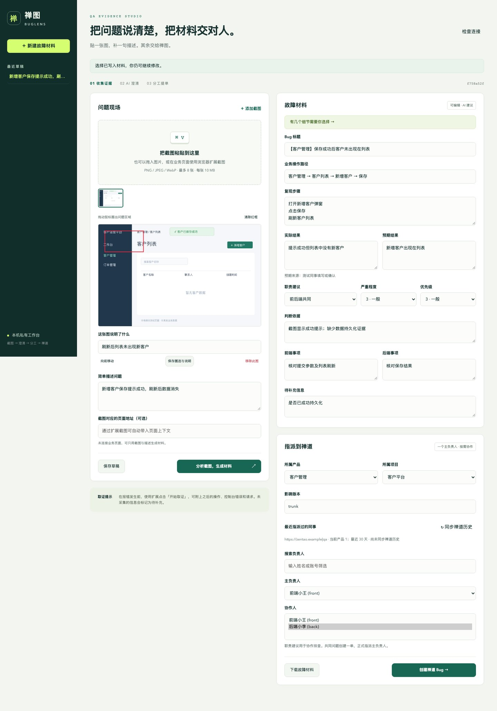

# 禅图 BugLens · 测试截图提单助手

测试同事只需**截图或圈出问题区域，补一句描述，选择推荐答案和负责人**，即可生成规范故障材料并提交禅道。

[使用说明：安装、首次配置、截图提单与常见问题](./docs/USER-GUIDE.zh-CN.md)



## 两个独立交付

### 1. DSH 插件

```sh
dsh plugin --profile web add dsh-zentao-buglens@0.1.0
dsh web
```

在 DSH 中说：“打开禅图 BugLens，帮我根据截图整理材料并提交禅道。”插件提供 10 个 `buglens_*` 工具：工作台、草稿创建/读取/修改、添加截图、AI 分析、人员推荐、导出、提单及结果核实。

独立工作台要求 Node.js 22.15+；本项目验收使用的 DSH 0.2.2-rc.1 要求 Node.js 24.9+、pnpm 10+。推荐 Node.js 24 LTS 或更新版本。

### 2. 独立 Skill

```sh
npx --yes dsh-zentao-buglens@0.1.0 install-skill
```

默认安装到 `~/.agents/skills/zentao-buglens`。支持标准 Skill 目录的工具可发现该技能，使用时输入 `$zentao-buglens`。它不依赖安装 DSH。

指定 Codex 或 Claude Code 技能目录：

```sh
npx --yes dsh-zentao-buglens@0.1.0 install-skill --target ~/.codex/skills
npx --yes dsh-zentao-buglens@0.1.0 install-skill --target ~/.claude/skills
```

安装命令保留已存在的同名 Skill，不覆盖个人修改。GitHub Release 也提供独立 Skill ZIP，解压后的 `zentao-buglens` 文件夹放入对应工具的 skills 目录即可。宿主何时刷新 Skill 列表取决于宿主；必要时重新打开会话。

使用通用 Skills CLI 从 GitHub 安装到 Codex（也可将 `codex` 改为 `claude-code` 等支持的宿主）：

```sh
npx skills add zhan1024/dsh-zentao-buglens --skill zentao-buglens -a codex -g
```

Skills CLI 安装成功与 skills.sh 排行榜展示是两种状态；网站索引由第三方处理。

## 配套浏览器扩展

使用现有 Chrome/Edge 登录业务系统。扩展负责采集页面地址、面包屑、标题、可见控件与截图；工作台负责圈选、推荐问题及提单。

1. 全局安装核心服务，保证扩展目录稳定：`npm install -g dsh-zentao-buglens@0.1.0`。
2. 运行 `dsh-zentao-buglens open` 打开本机工作台。
3. 运行 `dsh-zentao-buglens extension-path`，得到扩展文件夹；也可从 Release 下载扩展 ZIP 并解压到固定目录。
4. 在 `chrome://extensions` 或 `edge://extensions` 打开开发者模式，选择“加载已解压的扩展程序”，选该文件夹。
5. 点击扩展，把当前**完整工作台地址（含 #token=）**粘贴进去，保存配对。地址只在本机使用，不要公开。
6. 回到业务页面，填写简单描述，点击“截图并打开提单工作台”。

浏览器设置页、扩展商店及浏览器限制访问的页面不支持截图取证。工作台重启令牌更新后，扩展需要重新配对。当前提供开发者模式安装包，**不表示已获 Chrome 或 Edge 商店审核**。

## 实际操作

- **收集**：直接 `Ctrl/Cmd+V` 粘贴多图，支持拖入、排序、说明和红框。最多 8 张，每张不超过 10MB。
- **补充取证**：故障发生前在扩展点击“开始取证”，之后复现并截图。可选采集接口入参与 JSON 响应；仅采集开始之后的记录，最多保留 300 条。
- **AI 澄清**：点击“分析截图，生成材料”。根据推荐选项选择正确预期；选项不合适可自填。标题、UI 路径、步骤和分工均可直接编辑。
- **选择开发**：同步本人指派历史，显示最近指派时间和来源；也可选择当前团队成员。职责不足时保留“待定位”。
- **提单**：选择真实产品、项目、影响版本和主负责人，点击“创建禅道 Bug”。共同问题只建一单，正文列协作人及前后端事项。
- **取材料**：可单独下载含全部图片及红框的 HTML 材料。Markdown 与 HTML 同时保存在本机数据目录 `exports`。

生成内容包括：环境与页面、业务操作路径、复现步骤、实际与预期结果、预期依据、截图与圈选、前后端排查职责、主负责人、协作人、待补充信息，以及已采集的浏览器证据。

## 边界与恢复

截图不能证明服务器内部根因；HTTP 500 也不能单独证明责任归后端。后端日志和源码路径需另外提供。红色 UI 不一定是标注，外部截图中的红框由 AI 辅助识别；工具内画框有准确坐标。

“最近指派”仅包含可核验的本人操作历史，以及本工具以后成功指派的记录。默认扫描当前产品最近编号的最多 200 个可访问 Bug，取其中最近 30 天的本人指派事件。界面报告覆盖范围，不宣称全量；姓名不能唯一匹配时不会记入。站点未返回历史时仍可手动选择同事。

创建或附件超时会显示待核实。再次点击只查找或续传。若自动查不到，使用 CLI `reconcile` 核实真实编号；不要新建相同草稿反复提交。显示“部分完成”时，以逐项状态为准，不算全流程成功。

首次团队配置、凭据和版本兼容要求见 [配置说明](./docs/CONFIGURATION.md)。开发与发布操作见 [开发发布流程](./docs/DEVELOP-PUBLISH.md)。
